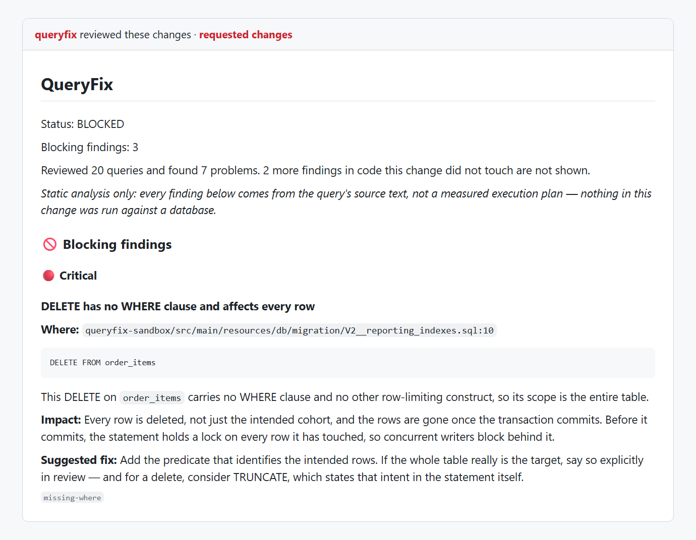
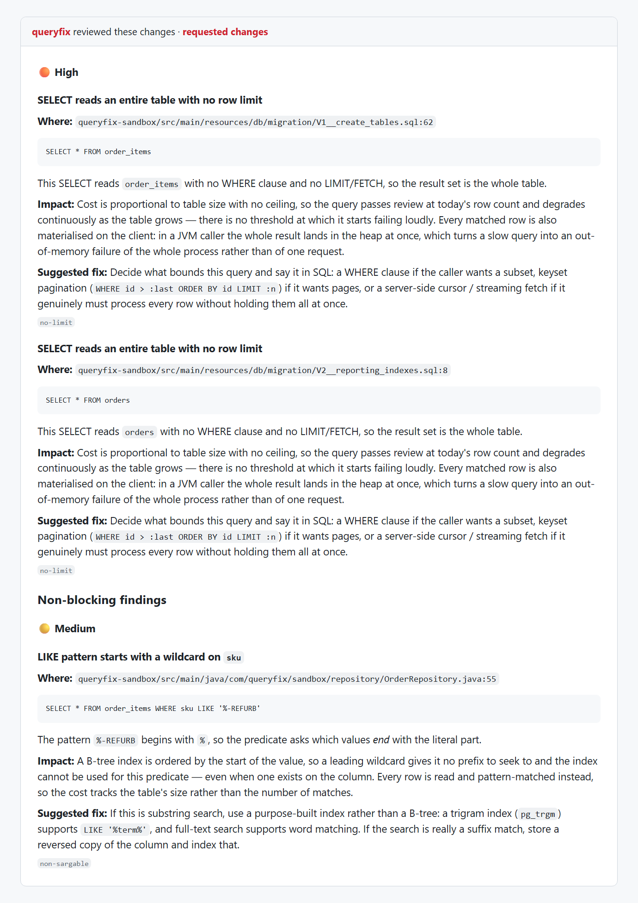

# QueryFix

**A pull-request bot that catches slow and unsafe database queries before they reach production.**

[](https://github.com/pranavv05/QueryFix/actions/workflows/ci.yml)
[](#quick-start)
[](#contributing)
[](#current-status)

---

QueryFix reads the database code in every pull request, finds the queries that will hurt at
production scale, and says so in a single GitHub review, with the exact line, the reason it
is slow, and a suggested fix. It understands raw SQL and migrations, JPQL/HQL, JPA native
queries and Spring Data derived methods, and it follows Java control flow across files to
spot N+1 access patterns that no single-query check can see.

- **Deterministic.** The same diff always produces the same findings, and every finding
  names its rule, file and line. The LLM is optional and only writes prose.
- **Quiet.** One review per PR, edited in place on every push, scoped to the lines the PR
  actually changed.
- **Safe.** It never approves, merges, pushes or edits code, and it never touches a real
  database. Advisory mode makes it comment-only.
- **Zero infrastructure.** One workflow file in the consuming repository; no server to run.

## Screenshots

Output from a real run of QueryFix on a recorded pull request that adds a reporting
migration and repository changes to the bundled [sandbox app](queryfix-sandbox/). The review
text is exactly what QueryFix posts; it is rendered here in a GitHub-style frame, and the
header strip is added for context. Reproduce it offline with
`queryfix review --repo pranavv05/QueryFix --pr 4 --fixture tests/fixtures/diffs --dry-run`.

**The review summary: status, counts, and the first blocking finding**



**Findings ranked by severity, each with evidence, impact and a fix**



---

## Why QueryFix?

**The problem.** A slow query almost never looks slow. `SELECT * FROM orders` passes
code review because at review time `orders` has 400 rows. `findByCustomerId` called
inside a `for` loop reads as ordinary Java: each execution is genuinely fast, and only
the five-thousandth repetition is the defect. A `WHERE country = ?` predicate looks
indexed until you check the migration and find it isn't. None of these are visible in a
diff, so they ship, and they surface months later as a pager alert with no obvious cause.

**The solution.** QueryFix reviews the queries in a pull request the way a database
specialist would. It extracts every query the diff touches, checks each against
deterministic rules, and reasons across the whole change for N+1 access patterns no
single-query rule can see. It posts the result as one GitHub Pull Request Review that is
edited in place on every push: `REQUEST_CHANGES` when something blocking was found,
`COMMENT` otherwise. QueryFix never approves, merges, or edits code. Whether a finding
actually stops a merge is governed by the repository's own branch protection, exactly as
for a human reviewer.

**How it differs from an LLM reviewer.** A general-purpose AI reviewer is broader;
QueryFix is narrower and repeatable. The same diff always produces the same findings,
every finding names a rule, a file and a line, it can be enforced per repository, and it
costs no model tokens by default. The two are complementary.

**Execution plans are not built yet.** Static analysis can say a query has no `WHERE`
clause; only a plan can say it scanned 2 million rows. The plan-backed stages (isolated
Postgres, `EXPLAIN`, HypoPG index simulation) are planned, not implemented, and nothing in
a report claims otherwise. See [Current Status](#current-status).

---

## Adopting it in a repository

Add one small workflow file; there is no server to run.

```yaml
# .github/workflows/queryfix.yml
name: QueryFix
on: pull_request
permissions:
  contents: read
  pull-requests: write
jobs:
  review:
    uses: <org>/QueryFix/.github/workflows/queryfix-review.yml@<tag-or-sha>
    with:
      advisory: true      # comment only, never block; recommended for the first weeks
      disable-llm: true   # no code leaves GitHub's runners
```

Optionally add a `.queryfix.yml` at the repository root to tune behaviour:

```yaml
block-severities: [critical]     # what blocks a merge (default: critical, high)
warn-rules: [no-limit]           # reported, never blocking
block-rules: [missing-where]     # always blocking, whatever the severity
disable-rules: [select-star]     # static rules that do not run at all
ignore-paths: ["**/legacy/**"]   # never analysed
```

Org-level settings outrank repository ones. The full guide, including the branch-protection
settings that make a blocking finding block, public versus private repositories, SQL
dialect detection and rollout advice, is in
[docs/adopting-queryfix.md](docs/adopting-queryfix.md).

---

## Features

### Available now

- **Pull-request ingest and diff parsing.** Reads PR diffs via PyGithub, parses unified
  diff hunks, records which lines the PR wrote, handles added, modified, renamed and
  deleted files, and degrades per file rather than failing.
- **Findings scoped to what the PR wrote.** Only queries and N+1 call sites on lines the
  PR added are reported. Findings in untouched code are counted in a one-line note, not
  shown. Override with `QUERYFIX_SCOPE=all`.
- **SQL extraction.** Every statement in a `.sql` file, migration or snippet, parsed with
  `sqlglot`. Semicolons inside string literals and dollar-quoted bodies are not treated as
  boundaries.
- **SQL dialect detection.** The dialect (MySQL, MariaDB, Postgres, Oracle, SQL Server) is
  read from the repository's JDBC URL, including multi-module repositories and
  `bootstrap.properties`. Override with `QUERYFIX_SQL_DIALECT`.
- **`@Query` and derived-method extraction.** Spring Data JPQL and native queries
  (including text blocks), and `findBy`/`countBy`/`existsBy`/`deleteBy` methods with
  equality predicates joined by `And`, with accurate `file:line` provenance.
- **Five static rules.** Unqualified writes, unbounded scans, unindexed filters,
  `SELECT *`, and non-sargable predicates. Each explains what it found, why it matters at
  scale, and how to fix it.
- **Cross-file N+1 detection.** Reads Java control flow (loops, repository call sites,
  cross-file type resolution), so it catches a repository call inside a loop or a lazy
  association dereferenced per row. Deterministic: whether a pattern is reported never
  depends on an LLM. Optional LLM prose (Groq) is reconciled against the structural
  evidence and can be disabled with `--no-llm` or `disable-llm: true`.
- **Honest evidence strength.** Findings carry a band (strong, moderate or weak) and a
  one-line reason, for example that the loop variable feeds the call's arguments. They are
  never shown as a percentage, because the number was an ordinal tier, not a probability.
- **Automatic Liquibase schema discovery.** No `LIQUIBASE_CHANGELOG_PATH` needed for a
  standard Spring Boot repository. Schema-dependent rules stay silent, not wrong, when
  nothing is found. See [docs/liquibase-schema-discovery.md](docs/liquibase-schema-discovery.md).
- **Deterministic, ranked findings.** Worst severity first, stable across runs.
- **A deterministic enforcement policy.** Every run resolves to exactly one of `PASS`,
  `BLOCKED`, `DEGRADED` or `FAILED`, from findings and stage health alone, never from
  prose. Blocking severities and rule IDs are configurable. **Advisory mode**
  (`advisory: true` / `QUERYFIX_ADVISORY`) makes the whole run comment-only.
- **Per-repository configuration.** `.queryfix.yml` with strict parsing; a typo is a
  reported configuration error, not a silently ignored setting.
- **A real GitHub Pull Request Review.** `REQUEST_CHANGES` or `COMMENT`, never `APPROVE`,
  idempotent via a hidden marker so a new push edits the existing review. The body is
  size-guarded below GitHub's 65,536-character limit, dropping the lowest-priority findings
  first and saying what it dropped.
- **A CLI.** `queryfix review --repo OWNER/REPO --pr N` with `--post-comment`,
  `--dry-run`, `--fixture` (fully offline), and `--no-llm`. Exit codes: `2` blocked,
  `1` could not analyse reliably, `3` configuration error, `0` otherwise.
- **A reusable GitHub Actions workflow.** Any repository adopts it with a small workflow
  file. Actions are pinned to commit SHAs and the job has a 15-minute timeout.
- **HTTP API.** `GET /health` and `POST /analyze`.
- **p6spy statement-log analysis.** Isolates an N+1 by shape from a real statement log.
- **Fail soft everywhere.** An unreadable file, a failed LLM call or an unreachable schema
  becomes a named caveat while everything else is still analysed.
- **A sandbox with real bugs.** A Spring Boot fixture app with four planted performance
  bugs, each beside a healthy counterpart, so rules are tested for false positives too.

### Not built yet

- **Execution plan analysis.** `EXPLAIN (ANALYZE, BUFFERS, FORMAT JSON)` on an isolated
  Postgres 16 clone inside `BEGIN` ... `ROLLBACK`. The biggest remaining gap.
- **Index simulation** with HypoPG and real before/after cost deltas.
- **Wider Java and JPA coverage.** `EntityManager`/`Session` queries, named queries,
  MyBatis, Kotlin, and Spring Data derived methods with nested properties or operators
  beyond equality.
- **Flyway schema support** (Liquibase only today).
- **Four more static rules.** Deep `OFFSET` paging, `IN` lists that should be joins,
  cartesian products, derived-method fan-out.
- **A central installation model** (a GitHub App), so upgrades do not mean editing every
  repository's workflow file.

---

## Architecture

A linear pipeline; each stage consumes the previous stage's typed output. Every contract
is an immutable Pydantic model, so a stage cannot edit its input.

```
              Pull Request
                   |
   [x] 1. Ingest             diff, base/head SHAs, lines the PR wrote
                   |
   [~] 2. Extraction         query text + file:line provenance, dialect-aware
                   |
   [x] 3. Static Analysis    deterministic rules over parsed ASTs
                   |
   [ ] 4. Provision          isolated Postgres 16 + HypoPG
                   |
   [ ] 5. Execution Plan     EXPLAIN ANALYZE inside BEGIN/ROLLBACK
                   |
   [ ] 6. HypoPG             simulated indexes, before/after cost
                   |
   [x] 7. N+1 Detection      cross-file structural analysis + optional LLM prose
                   |
   [x] 8. Report             findings -> ranked, size-guarded Markdown
                   |
   [x] 9. Enforcement        PASS / BLOCKED / DEGRADED / FAILED, deterministic
                   |
        GitHub Pull Request Review   REQUEST_CHANGES / COMMENT, never APPROVE
```

`[x]` implemented and tested, `[~]` partial (SQL and core Java/JPQL forms), `[ ]` entry
point exists but raises `NotImplementedError`. Stages 4 to 6 are not wired, and the
pipeline does not pretend otherwise. Stage contracts and extension points are in
[docs/architecture.md](docs/architecture.md).

### Design invariants

These hold for every stage, present and future:

1. **Never connect to a developer or production database.** Every run clones an isolated
   reference database from a schema snapshot.
2. **Every statement runs inside `BEGIN` ... `ROLLBACK`.** Nothing QueryFix executes can
   commit.
3. **QueryFix's only write action is its own GitHub Pull Request Review.** It never
   merges, pushes a commit, edits a file, creates or closes a pull request, or touches
   another actor's comment or review.
4. **One review per PR, updated in place**, identified by a hidden marker.
5. **Fail soft.** A crashed stage degrades the report; it does not fail the check unless
   the enforcement policy says a real finding warrants it.

---

## Quick Start

**Requirements:** Python 3.11+. No Docker or JDK needed for anything below.

```bash
git clone https://github.com/pranavv05/QueryFix.git
cd QueryFix
pip install -e ".[dev]"
pytest
```

### Review a real pull request from the command line

```bash
export GITHUB_TOKEN=ghp_...                       # read access is enough for --dry-run
queryfix review --repo OWNER/REPO --pr 42 --dry-run
```

Drop `--dry-run` and grant the token pull-request write access to post the review. To run
fully offline against a recorded PR, use `--fixture`.

### Start the HTTP API

```bash
uvicorn queryfix.api.main:app --reload     # docs at http://localhost:8000/docs
```

### Use it as a library

```python
from queryfix.models import SqlSource
from queryfix.pipeline.runner import AnalysisRunner

report = AnalysisRunner().run(
    repo="acme/billing-service",
    pr_number=42,
    sources=[SqlSource(path="migrations/003_orders.sql", content="SELECT * FROM orders")],
)

for finding in report.findings:
    print(f"{finding.severity.value:8} {finding.rule_id:16} {finding.title}")
```

```
high     no-limit         SELECT reads an entire table with no row limit
medium   select-star      Query selects every column with `SELECT *`
```

---

## Configuration

All settings come from environment variables, read only in `queryfix/config.py`.

| Variable | Purpose | Default |
| --- | --- | --- |
| `QUERYFIX_BLOCK_SEVERITIES` | Severities that block | `CRITICAL,HIGH` |
| `QUERYFIX_BLOCK_RULES` / `WARN_RULES` / `IGNORE_RULES` | Rule-level overrides | none |
| `QUERYFIX_ADVISORY` | Comment-only mode, blocks nothing | off |
| `QUERYFIX_SCOPE` | `changed` (lines the PR wrote) or `all` | `changed` |
| `QUERYFIX_SQL_DIALECT` | Force a SQL dialect instead of detecting it | detected |
| `GITHUB_TOKEN` | GitHub access | required for live runs |
| `GROQ_API_KEY` | Optional LLM prose | unset (off) |

---

## Testing

About 1,000 unit tests run in seconds with no Docker, JDK, credentials or network. CI runs
`ruff format --check`, `ruff check`, `mypy` (strict) and `pytest` on Python 3.11 and 3.12.

```bash
pytest                                  # everything
pytest tests/unit/static_rules/ -v      # the rule suites
pytest tests/unit/nplusone/ -v          # cross-file N+1 detection
pytest tests/unit/test_policy.py -v     # enforcement policy
```

Every rule ships with a false-positive guard as well as a positive case, because a review
bot that cries wolf gets muted. The pipeline is also tested for determinism, lossless JSON
round-tripping, and internal consistency of findings. Tests needing Docker will live behind
the `integration` marker; none exist yet because the stages that need one are not built.

---

## Current Status

**Pilot ready, not battle-tested.** Static analysis, cross-file N+1 detection, the
enforcement policy, per-repository configuration, advisory mode and Pull Request Review
posting are implemented and tested. The tool has been checked against a small number of
real pull requests from one Spring Boot codebase, so its false-positive rate on broad
real-world traffic is not yet known. Start in advisory mode.

What is not real yet is the plan-backed half: no `EXPLAIN` plan is produced and no index
impact is measured. Use it today as a deterministic SQL and JPA static-analysis PR bot with
real cross-query N+1 detection, not as a source of plan-verified findings.

Known limitations: no `EntityManager.createQuery`, named queries, MyBatis or Kotlin;
Spring Data derived methods with nested properties are not decoded (so those queries are
silently not reported); schema-aware rules need Liquibase.

---

## Documentation

| Document | For |
| --- | --- |
| [docs/adopting-queryfix.md](docs/adopting-queryfix.md) | Teams: adding it to a repository, configuration, rollout |
| [docs/architecture.md](docs/architecture.md) | Engineers: stage contracts and extension points |
| [docs/liquibase-schema-discovery.md](docs/liquibase-schema-discovery.md) | How the schema is found |
| [CLAUDE.md](CLAUDE.md) | Contributors: conventions and design rules |

---

## Contributing

Read [CLAUDE.md](CLAUDE.md) first. In brief:

- **Type hints everywhere**, checked by `mypy --strict`.
- **Pydantic models are the stage contracts**, never bare dicts or tuples.
- **Parse SQL with `sqlglot`; never regex it.** If it cannot parse, record the query as
  unanalyzable rather than guessing.
- **No bare `except`.** Fail soft at the stage boundary and return a degraded result.
- **Formatting and linting:** `ruff format` and `ruff check`, line length 100.

**Adding a source language:** add a module under `queryfix/pipeline/extract/` with
`extract(source: SourceFile) -> list[ExtractedQuery]`, then register it in
`extract/dispatcher.py`. Nothing downstream changes.

**Adding a static rule:** add one file under `queryfix/pipeline/static_rules/rules/`
named after the smell, import it in `static_rules/__init__.py` (registration is an import
side effect), add its ID to the registry assertion in `tests/unit/test_placeholders.py`,
and ship at least one query it must flag and one similar query it must not.

**Before opening a pull request:** `ruff format . && ruff check . && mypy && pytest`

Do not weaken the design invariants for convenience, and do not mark unfinished work as
complete in the documentation.

---

## License

Released under the [MIT License](LICENSE).
